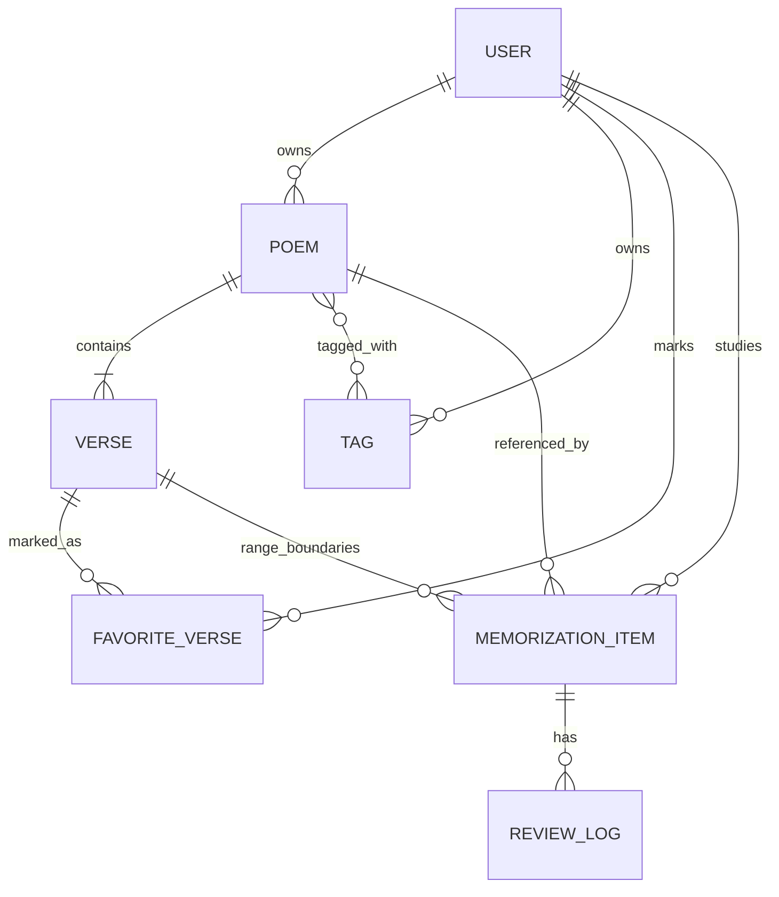
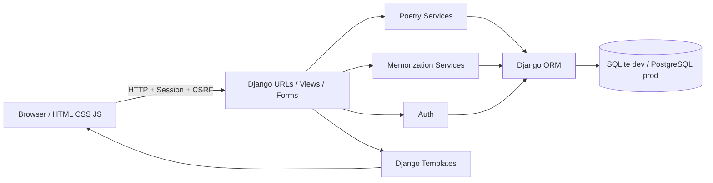

# سند جامع توسعه MVP سامانهٔ شخصی حفظ و مرور شعر

> **نوع سند:** Product Requirements + Functional Specification + UI/UX Specification + Technical Design + Implementation Plan  
> **نسخه:** 1.0  
> **تاریخ تدوین:** ۱۴۰۵/۰۸/۱۹ (۲۰۲۶-۱۱-۱۰)  
> **زبان رابط کاربری:** فارسی (RTL)  
> **وضعیت:** مشخصات آمادهٔ پیاده‌سازی توسط توسعه‌دهنده یا ایجنت هوش مصنوعی

---

## ۰. راهنمای استفاده از این سند برای ایجنت‌های برنامه‌نویسی

این فایل «منبع حقیقت» (Single Source of Truth) پروژه است. هدف، تولید کد قابل‌اجرا و تست‌شده است؛ نه صرفاً طراحی ظاهری یا ارائهٔ نمونهٔ نمایشی.

1. قبل از کدنویسی، بخش‌های **۱ تا ۹** را برای درک محصول، مدل دامنه، جریان‌ها و قراردادهای فنی بخوان.
2. ساختار پیشنهادی بخش **۱۰** را بساز و طبق مراحل بخش **۱۷** پیش برو.
3. هر مرحله باید migration، view، template، استایل، تست، و مستندات مربوط به خود را داشته باشد؛ صرف ساخت صفحات نمایشی کافی نیست.
4. از تکنولوژی‌های تعیین‌شده فراتر نرو مگر با ذکر دلیل فنی و تأیید مالک پروژه. به‌ویژه **SPA/React/Vue/Next.js/DRF/Celery** را به‌صورت پیش‌فرض اضافه نکن.
5. هر جا سند بین دو راهکار گزینه گذاشته است، **گزینهٔ پیش‌فرض مشخص‌شده** را اجرا کن. ابهام‌های غیرمسدودکننده را در `docs/decisions.md` ثبت کن و متوقف نشو.
6. هیچ متنی از شعرها یا توضیحات کاربران را به‌صورت HTML خام به صفحه تزریق نکن.
7. خروجی هر مرحله باید با معیارهای پذیرش بخش **۱۶** سنجیده شود؛ در پایان گزارش بده چه چیزی اجرا، تست، و چه چیزی خارج از اسکوپ مانده است.

### تعریف «انجام‌شده»

یک قابلیت زمانی آماده است که در مرورگر قابل استفاده باشد، دادهٔ واقعی در پایگاه داده ذخیره شود، مالکیت داده کنترل شود، در موبایل قابل استفاده باشد، حالت خطا/خالی داشته باشد و تست مربوطه موفق شود.

---

## ۱. چشم‌انداز محصول

### ۱.۱. مسئله

کاربر به‌طور مداوم شعر فارسی می‌خواند و می‌خواهد شعرهای محبوبش را در یک کتابخانهٔ شخصی نگه دارد، آن‌ها را با تگ سازمان‌دهی کند، بیت‌های خاص را «شاه‌بیت» علامت بزند، و تمام یا بخشی از شعرها را به کمک مرور زمان‌بندی‌شده حفظ کند.

### ۱.۲. هدف MVP

محصول باید چرخهٔ اصلی زیر را **از ابتدا تا انتها** اجرا کند:

`افزودن شعر ← سازمان‌دهی با تگ ← انتخاب محدوده برای حفظ ← مرور فعال ← ثبت کیفیت یادآوری ← تعیین مرور بعدی`

در کنار چرخهٔ اصلی، کشف تصادفی شعر و کتابخانهٔ شاه‌بیت‌ها نیز در دسترس است.

### ۱.۳. اصول محصول

- **محتوا محور:** نمایش زیبا و خوانای شعر از جلوه‌های بصری مهم‌تر است.
- **کم‌اصطکاک:** ذخیرهٔ شعر، انتخاب بیت و شروع مرور باید با کمترین کلیک انجام شود.
- **مرور واقعی:** فقط یک لیست «برای حفظ» کافی نیست؛ زمان‌بندی و ثبت عملکرد لازم است.
- **حریم خصوصی:** کتابخانه و پیشرفت حفظ، خصوصی و مختص حساب واردشده است.
- **سادگی فنی:** معماری یکپارچه (monolith) با Django؛ بدون سرویس‌ها و وابستگی‌های غیرضروری.
- **زبان و فرهنگ:** نمایش صحیح خط فارسی، نیم‌فاصله، شعر دو‌مصرعی، راست‌به‌چپ و تایپوگرافی مناسب.
- **قابل توسعه:** مرزبندی مدل‌ها و سرویس‌ها باید امکان افزودن یادآور، همگام‌سازی و نسخهٔ عمومی را در آینده بدهد.

### ۱.۴. مخاطب و فرض‌های MVP

- کاربر اصلی یک فرد است؛ اما مدل‌ها دارای فیلد `owner` خواهند بود تا جداسازی حساب‌ها رعایت شود.
- ورود با نام کاربری و رمز عبور الزامی است.
- ثبت‌نام عمومی، ایمیل تأیید، ورود با گوگل و اشتراک‌گذاری عمومی جزو MVP نیستند.
- ایجاد حساب اولیه از طریق دستور مدیریت Django انجام می‌شود.
- محتوای شعر به‌صورت دستی وارد می‌شود؛ اتصال به گنجور، scraping، OCR و واردسازی فایل در این نسخه وجود ندارد.
- کتابخانه معمولاً کوچک تا متوسط است؛ بهینه‌سازی برای میلیون‌ها شعر لازم نیست.

---

## ۲. محدودهٔ دقیق MVP

| شناسه | قابلیت درخواستی | خروجی مورد انتظار | اولویت |
|---|---|---|---|
| F01 | اضافه کردن شعر | ساخت شعر با شاعر، عنوان اختیاری و یک یا چند بیت/سطر | ضروری |
| F02 | افزودن شعر/چند بیت به فهرست حفظ | ساخت کارت حفظ برای تمام شعر یا یک بازهٔ پیوسته از بیت‌ها | ضروری |
| F03 | پیشنهاد شعر تصادفی | نمایش شعر تصادفی از کتابخانه، با دکمهٔ «یکی دیگر» | ضروری |
| F04 | نسبت‌دادن چند تگ به شعر | افزودن/حذف تگ‌ها هنگام ثبت یا ویرایش شعر | ضروری |
| F05 | ساخت تگ جدید | ایجاد، تغییر نام و حذف تگ متعلق به کاربر | ضروری |
| F06 | نمایش شعرها بر اساس تگ | صفحهٔ هر تگ با فهرست شعرهای منتسب | ضروری |
| F07 | صفحهٔ شاه‌بیت‌ها | نمایش بیت‌های منتخب با شاعر و لینک شعر مادر | ضروری |
| F08 | افزودن بیت به شاه‌بیت‌ها | نشان/برداشتن نشان علاقه‌مندی از یک بیت | ضروری |
| F09 | مرور فاصله‌دار | صف مرور، آشکارسازی جواب، ثبت نتیجه، محاسبهٔ نوبت بعد | ضروری و مکمل هدف اصلی |
| F10 | کتابخانه و جزئیات شعر | مرور شعرهای ذخیره‌شده و مشاهدهٔ متن کامل | ضروری و پیش‌نیاز F01 |
| F11 | ویرایش و مدیریت داده | ویرایش شعر، آرشیو شعر، کنترل کارت‌ها | ضروری و حداقلی |
| F12 | احراز هویت | ورود، خروج و محافظت از داده‌های شخصی | ضروری |

### خارج از محدوده (Non-Goals)

اپلیکیشن موبایل بومی؛ موتور جست‌وجوی سراسری شعر؛ هوش مصنوعی برای سنجش حفظ؛ تشخیص صوت؛ تولید خودکار شعر؛ اشتراک‌گذاری عمومی؛ دنبال‌کردن کاربران؛ آزمون چندگزینه‌ای؛ اعلان پوش؛ ارسال ایمیل؛ استخراج متن از تصویر؛ gamification سنگین؛ واردسازی انبوه از منابع اینترنتی؛ پنل مدیریت اختصاصی چندنقشی؛ تنظیم الگوریتم یادگیری توسط کاربر؛ چندزبانه‌بودن رابط.

**نکته:** نبود این امکانات نباید مانع تحویل MVP شود.

---

## ۳. سناریوهای اصلی کاربر (User Flows)

### U01 — ذخیرهٔ یک شعر

1. کاربر وارد سایت می‌شود و «افزودن شعر» را انتخاب می‌کند.
2. عنوان (اختیاری)، نام شاعر، منبع (اختیاری)، یادداشت (اختیاری) و متن ابیات را ثبت می‌کند.
3. می‌تواند به‌صورت سطرهای ساختاریافته یا با چسباندن متن (bulk paste) شعر را وارد کند.
4. پیش‌نمایش ابیات را مشاهده و خطاها را اصلاح می‌کند.
5. تگ‌های موجود را برمی‌گزیند یا تگ جدید می‌سازد.
6. با ذخیره، به صفحهٔ جزئیات شعر هدایت می‌شود.

**شرط موفقیت:** شعر و ابیات، با ترتیب صحیح، پس از بارگذاری مجدد باقی می‌مانند.

### U02 — حفظ یک غزل کامل

1. در صفحهٔ شعر، دکمهٔ «افزودن تمام شعر به حفظ» را می‌زند.
2. یک آیتم حفظ با محدودهٔ `full` ایجاد می‌شود.
3. آیتم در «فهرست حفظ» و اگر زمانش رسیده باشد در «مرور امروز» ظاهر می‌شود.
4. ایجاد دوبارهٔ همان آیتم باعث تکثیر آن نمی‌شود؛ پیام «قبلاً اضافه شده» نمایش داده می‌شود.

### U03 — حفظ چند بیت از یک غزل

1. در صفحهٔ شعر، «انتخاب ابیات برای حفظ» را فعال می‌کند.
2. بازهٔ پیوستهٔ بیت‌های آغاز تا پایان را انتخاب می‌کند (یک بیت نیز مجاز است).
3. محدودهٔ انتخابی پیش از تأیید هایلایت می‌شود.
4. آیتم حفظ بازه‌ای ایجاد می‌شود؛ عنوان شعر و شمارهٔ بیت‌های انتخابی در آن دیده می‌شود.
5. انتخاب بازهٔ عیناً تکراری مجاز نیست؛ بازه‌های هم‌پوشان ولی متفاوت مجازند و می‌توان دربارهٔ تکرار آن‌ها هشدار غیرمسدودکننده داد.

### U04 — مرور حفظ

1. کاربر وارد «مرور امروز» می‌شود و تعداد کارت‌های سررسیدشده را می‌بیند.
2. نخست فقط نام شاعر، عنوان شعر و **مصرع اولِ نخستین بیت** به‌عنوان راهنما نشان داده می‌شود.
3. کاربر تلاش می‌کند ادامهٔ محدوده را از حفظ بخواند.
4. «نمایش پاسخ» را می‌زند و متن کامل را می‌بیند.
5. یکی از گزینه‌های «دوباره»، «سخت»، «خوب» یا «آسان» را می‌زند.
6. ارزیابی ذخیره، موعد بعد محاسبه و کارت بعدی نمایش داده می‌شود.
7. وقتی کارتی سررسید نیست، پیام واضح «مروری برای الان باقی نمانده» نشان داده می‌شود.

### U05 — پیدا کردن شعر با تگ

کاربر وارد صفحهٔ تگ‌ها می‌شود، مثلاً «عاشقانه» را انتخاب می‌کند و شعرهایی را که همان تگ دارند می‌بیند. تگ‌ها باید با جست‌وجوی نام فارسی در فرم‌ها قابل پیدا کردن باشند؛ جست‌وجوی پیشرفتهٔ متن شعر لازم نیست.

### U06 — ثبت و مرور شاه‌بیت

کاربر کنار بیت دلخواه روی نشان شاه‌بیت کلیک می‌کند. نشان بلافاصله تغییر می‌کند و همان بیت در صفحهٔ «شاه‌بیت‌ها» با اطلاعات شعر و شاعر نمایش داده می‌شود. کلیک دوباره نشان را برمی‌دارد.

### U07 — کشف تصادفی

کاربر وارد صفحهٔ «کشف شعر» می‌شود، یک شعر تصادفی از **شعرهای فعال همان کاربر** می‌بیند و با «شعر دیگری» شعر تازه‌ای دریافت می‌کند. در صورت امکان شعر فعلی در انتخاب بعدی تکرار نمی‌شود.

---

## ۴. نقشهٔ صفحات و ناوبری

### ۴.۱. صفحات

| مسیر | نام صفحه | محتوای اصلی |
|---|---|---|
| `/login/` | ورود | فرم نام کاربری و رمز |
| `/` | پیشخوان | آمار ساده، مرورهای موعددار، دسترسی سریع |
| `/poems/` | کتابخانه | کارت/فهرست شعرها، شمار ابیات، شاعر، تگ‌ها |
| `/poems/new/` | افزودن شعر | ویرایشگر و پیش‌نمایش |
| `/poems/<id>/` | جزئیات شعر | متن کامل، شاه‌بیت، انتخاب محدودهٔ حفظ |
| `/poems/<id>/edit/` | ویرایش شعر | اصلاح اطلاعات و ابیات مجاز |
| `/tags/` | تگ‌ها | فهرست تگ‌ها، ایجاد، ویرایش، حذف |
| `/tags/view/<slug>/` | شعرهای یک تگ | فهرست شعرها با آن تگ |
| `/favorites/` | شاه‌بیت‌ها | بیت‌های منتخب و اطلاعات شعر |
| `/memorize/` | فهرست حفظ | تمام آیتم‌های حفظ و وضعیت آن‌ها |
| `/review/` | مرور امروز | صف و رابط تمرین مرور |
| `/discover/` | کشف شعر | پیشنهاد تصادفی و تکرار پیشنهاد |

در مسیرهای پویای فوق `<id>` فقط نام نمایشی است؛ در `urls.py` از `<int:pk>` استفاده شود. برای نام فارسی تگ، تبدیل‌کنندهٔ `<str:slug>` استفاده شود، نه `<slug:slug>` پیش‌فرضِ محدود به ASCII. پیشوند `/tags/view/` از برخورد نام تگ با مسیرهایی مانند `/tags/new/` جلوگیری می‌کند.

### ۴.۲. ناوبری

- منوی دسکتاپ: «پیشخوان»، «کتابخانه»، «مرور»، «شاه‌بیت‌ها»، «تگ‌ها»، «کشف شعر»، «افزودن شعر».
- ناوبری موبایل: منوی بازشوندهٔ دسترس‌پذیر با دکمهٔ واضحِ «مرور» و «افزودن شعر».
- نشان شمارش مرورهای سررسیدشده کنار «مرور»؛ مقدار از پایگاه داده محاسبه شود، نه مقدار ثابت.
- breadcrumb در جزئیات شعر، صفحهٔ تگ و ویرایش.
- دکمهٔ خروج با متد `POST`، نه لینک GET.

---

## ۵. طراحی بصری و تجربهٔ کاربری (Design System)

### ۵.۱. جهت هنری

**نام کاری تم: «روزنامهٔ کاهی / دفتر اشعار کهن»**

الهام از روزنامه‌های کاهی قدیمی، صفحه‌آرایی مطبوعات فارسی، حاشیه‌های باریک تیره، سرستون، تیترهای درشت سنتی، سرفصل‌های خوش‌ریتم، خط‌کشی‌های دوگانه، مهرهای چاپی محدود و زمینهٔ کاغذی. ظاهر باید اصیل و خوانا باشد، نه شلوغ یا فرسوده.

**ضروری است** سایت با نگاه اول به یک دفتر شعر چاپی قدیمی شباهت داشته باشد، ولی از نظر تعاملات و دسترسی‌پذیری، وب‌اپلیکیشن مدرن باقی بماند.

### ۵.۲. توکن‌های اولیهٔ CSS

```css
:root {
  --paper: #eee1c3;
  --paper-light: #f8f0dc;
  --paper-dark: #dccaa4;
  --ink: #342b21;
  --ink-muted: #6c5c47;
  --accent: #823e2f;
  --accent-hover: #692f25;
  --rule: #aa9671;
  --success: #425d43;
  --danger: #9a302c;
  --focus: #2e5f80;
  --space-1: 0.25rem;
  --space-2: 0.5rem;
  --space-3: 0.75rem;
  --space-4: 1rem;
  --space-6: 1.5rem;
  --space-8: 2rem;
  --space-12: 3rem;
  --content-width: 72rem;
  --poem-width: 46rem;
  --radius: 0.2rem;
  --shadow-paper: 0 2px 10px rgba(52, 43, 33, 0.08);
}
```

رنگ‌ها نقطهٔ شروع‌اند؛ هنگام پیاده‌سازی کنتراست متن عادی و پس‌زمینه حداقل `4.5:1` و متن درشت حداقل `3:1` بررسی شود. وضعیت‌ها فقط با رنگ مشخص نشوند.

### ۵.۳. تایپوگرافی

- بدنه و اجزای فرم: **Vazirmatn** یا فونت فارسی خوانای دارای مجوز بازتوزیع؛ fallback شامل `Tahoma`, `sans-serif`.
- تیترها و نام صفحه: خانوادهٔ نسخ/سنتیِ دارای مجوز و پشتیبانی کامل از حروف فارسی، مانند نسخهٔ مناسب **Noto Naskh Arabic**؛ کیفیت نمایش «پ»، «چ»، «ژ»، «گ» آزمایش شود.
- انتخاب فونت خوشنویسی برای **لوگو یا سربرگ** اختیاری است؛ متن اصلی شعر نباید به خاطر جلوهٔ هنری ناخوانا شود.
- فونت‌ها ترجیحاً self-host با فایل مجاز و اطلاعیهٔ مجوزشان؛ وابستگی اجباری به سرویس فونت خارجی وجود نداشته باشد.
- متن شعر: در موبایل حدود `1.2rem` تا `1.4rem` و در دسکتاپ حدود `1.45rem` تا `1.7rem` با فاصلهٔ خط مناسب (`1.9` تا `2.3` بسته به فونت).
- استفاده از `font-variant-numeric`/فونت مناسب برای نمایش درست ارقام فارسی در صفحه؛ در دیتابیس شناسه‌ها عددی باقی می‌مانند.

### ۵.۴. عناصر هویتی

1. **Masthead:** سربرگ شبیه نام روزنامه با عنوان سایت و خط افقی دوبل.
2. **Paper texture:** با گرادیان‌های CSS بسیار ظریف؛ بافت نباید پشت نوشته نویز ایجاد کند.
3. **Poetry panel:** زمینهٔ روشن‌تر از صفحه، حاشیهٔ چاپی و عنوانی با حس صفحهٔ کتاب.
4. **Divider:** خط ظریف یا دو خط موازی بین بخش‌ها.
5. **Stamp/label:** برچسب‌های کوچک مانند «منتخب»، «امروز»، «شاه‌بیت» با رنگ زرشکی/قهوه‌ای، نه آیکون‌های بسیار مدرن و رنگارنگ.
6. **Ink interactions:** hover ظریف، خط زیر متن و تغییر تُن جوهر، نه افکت‌های برجسته یا انیمیشن‌های نمایشی طولانی.

### ۵.۵. چیدمان شعر

- یک بیت دو‌مصرعی، در عرض کافی به‌صورت دو مصرع در یک ردیف دو‌ستونی متوازن و در عرض کم به‌صورت دو خط زیر هم نمایش داده شود.
- ترتیب مصرع‌ها در حالت RTL: مصرع اول در ستون راست و مصرع دوم در ستون چپ.
- متن با `direction: rtl`, `text-align: center` در نمایش اصلی شعر؛ متن فرم‌ها و یادداشت‌ها راست‌چین.
- نیم‌فاصله، علامت‌ها و کشیدگی‌ها **همان‌طور که کاربر وارد کرده** حفظ شوند.
- شمارهٔ بیت کوچک و اختیاری در کنار هر بیت؛ کنترل شاه‌بیت و انتخاب حفظ در کنار بیت، نه داخل متن آن.
- شعر نو یا بیت تک‌سطره که مصرع دوم ندارد، با یک سطر کامل نمایش داده شود.
- حداکثر عرض متن شعر محدود شود تا روی مانیتور عریض از هم گسیخته نشود.

### ۵.۶. رفتار واکنش‌گرا

| عرض تقریبی | رفتار |
|---|---|
| کمتر از 640px | یک ستون، مصرع‌ها زیر هم، منوی فشرده، دکمه‌های لمسی حداقل حدود 44px |
| 640 تا 1024px | صفحهٔ محتوا یک ستون و کارت‌های قابل چینش |
| بالاتر از 1024px | ستون اصلی و سایدبار سبک برای تگ‌ها/اطلاعات جانبی؛ متن شعر همچنان محدود |

استفاده از `clamp()` برای اندازهٔ فونت و فضاها، media query برای حالت موبایل و `prefers-reduced-motion: reduce` ضروری است.

### ۵.۷. ریزتعامل‌ها و حالت‌ها

- وضعیت hover، focus-visible، active و disabled برای تمام کنترل‌ها.
- پیام موفقیت/خطای واضح به زبان فارسی؛ برای عملیات AJAX با `role="status"` یا `aria-live`.
- skeleton پیچیده لازم نیست؛ وضعیت «در حال بارگذاری» کوتاه و معنادار کافی است.
- دکمهٔ شاه‌بیت با `aria-pressed` بیان کند فعال است یا خیر.
- در صفحهٔ مرور، پیش از نمایش پاسخ، دکمه‌های امتیازدهی غیرفعال باشند.
- خطاهای فرم کنار همان فیلد و در خلاصهٔ بالای فرم نمایش داده شوند.
- UI بدون JavaScript باید برای ثبت شعر، تگ، شاه‌بیت و مرور تا حد معقول با فرم‌های POST کار کند؛ AJAX فقط بهبود تجربه است.

### ۵.۸. چک‌لیست کیفیت ظاهری

- [ ] احساس صفحهٔ چاپی قدیمی بدون کاهش خوانایی.
- [ ] نمایش صحیح ابیات فارسی در Chrome و Firefox.
- [ ] در عرض 360px هیچ اسکرول افقی ناخواسته‌ای وجود نداشته باشد.
- [ ] هیچ متن یا دکمه‌ای در بافت کاغذ گم نشود.
- [ ] انتخاب بیت با لمس گوشی ساده باشد.
- [ ] عناصر صفحه هنگام تغییر فونت یا طول شعر به‌هم نریزند.

---

## ۶. مدل داده (Domain Model)

### ۶.۱. قواعد عمومی

- از `django.contrib.auth.models.User` برای MVP استفاده شود؛ تغییر به Custom User پس از آغاز migration دشوار است، بنابراین **پیشنهاد بهتر**: از ابتدا یک مدل حداقلی `accounts.User(AbstractUser)` در پروژه تعریف و `AUTH_USER_MODEL` تنظیم شود؛ **بدون فیلد سفارشی ضروری**. این تصمیم باید **پیش از اولین migration** اعمال شود.
- تمام داده‌های خصوصی به `owner` متصل باشند؛ ارجاع به کاربر با `settings.AUTH_USER_MODEL` انجام شود.
- همهٔ زمان‌ها در دیتابیس timezone-aware و مبتنی بر UTC ذخیره شوند (`USE_TZ=True`).
- منطقهٔ زمانی پیش‌فرض نمایش/محاسبهٔ روز: `Asia/Tehran` از تنظیم `APP_TIME_ZONE`؛ در آینده قابل تبدیل به تنظیم کاربر.
- `created_at`, `updated_at` برای اشیای اصلی ثبت شود.
- `id` از کلید اصلی استاندارد Django (`BigAutoField`) استفاده کند.
- برای نام‌های نمایشی از یونیکد کامل استفاده شود؛ متن را بی‌اجازه اصلاح املایی نکن.

### ۶.۲. جدول مدل‌ها

#### User (`accounts.User`)

| فیلد | نوع | توضیح |
|---|---|---|
| فیلدهای پایهٔ Django | `AbstractUser` | username, password و ... |

کاربر اولیه با `createsuperuser` ساخته می‌شود؛ به‌صورت پیش‌فرض ثبت‌نام عمومی نداریم.

#### Poem (`poetry.Poem`)

| فیلد | نوع | قاعده |
|---|---|---|
| `id` | PK | خودکار |
| `owner` | FK User | الزامی؛ cascade در حذف واقعی کاربر |
| `title` | CharField(200) | اختیاری؛ اگر خالی بود نمایش «شعر با مطلع ...» از بیت اول |
| `poet_name` | CharField(160) | الزامی؛ امکان مقدار «نامشخص» با انتخاب آگاهانهٔ کاربر |
| `source_url` | URLField(500) | اختیاری؛ منبع/لینک |
| `notes` | TextField | اختیاری، متن خام |
| `tags` | M2M Tag | با اعتبارسنجی مالک یکسان |
| `archived_at` | DateTimeField(null=True) | آرشیو نرم؛ حذف فیزیکی معمولی از UI ندارد |
| `created_at`, `updated_at` | DateTimeField | خودکار |

**قواعد:** شعر فعال حداقل یک بیت دارد. شعر آرشیوشده از کتابخانهٔ فعال، پیشنهاد تصادفی، شاه‌بیت‌ها و صف مرور حذف می‌شود؛ روابط و تاریخچه پاک نمی‌شوند. امکان بازگردانی شعر از بخش مدیریت/نمای آرشیو لازم است. عنوان اجباری نیست؛ شاعر در صورت ناشناس بودن به‌صورت صریح «نامشخص» ثبت می‌شود.

#### Verse (`poetry.Verse`)

| فیلد | نوع | قاعده |
|---|---|---|
| `id` | PK | پایدار |
| `poem` | FK Poem | الزامی، `on_delete=CASCADE` صرفاً در حذف واقعی شعر |
| `position` | PositiveIntegerField | ترتیب از 1 |
| `hemistich_1` | TextField | غیرخالی، حداکثر طول منطقی در فرم مثلاً 1000 کاراکتر |
| `hemistich_2` | TextField(blank=True) | اختیاری برای سطر تک‌خطی |

**قید:** `UniqueConstraint(poem, position)`؛ `CheckConstraint(position >= 1)`. ترتیب نمایش با `position` و سپس `id`. متن شعر در سطح Verse حفظ می‌شود تا انتخاب یک بیت ممکن باشد.

#### Tag (`poetry.Tag`)

| فیلد | نوع | قاعده |
|---|---|---|
| `id` | PK | خودکار |
| `owner` | FK User | الزامی |
| `name` | CharField(60) | الزامی؛ بعد از trim و نرمال‌سازی نباید خالی باشد |
| `slug` | CharField(90) | یونیکد مجاز؛ یکتا در محدودهٔ همان کاربر |
| `created_at` | DateTimeField | خودکار |

**قواعد:** تگ‌های «عاشقانه» و « عاشقانه » تکراری محسوب می‌شوند؛ تفاوت ک/ك و ی/ي در نام تگ تا جای ممکن یکسان‌سازی شود، ولی متن شعر دستکاری نشود. از `slugify(name, allow_unicode=True)` استفاده شود؛ در برخورد slug تکراری پسوند یکتا ایجاد گردد. برای پیشگیری از نام‌های تکراری، کلید نرمال‌شده یا قید case-insensitive مبتنی بر دیتابیس با تست SQLite و PostgreSQL به‌کار رود. حذف تگ فقط ارتباط آن با شعرها را حذف می‌کند و خود شعر باقی می‌ماند.

#### FavoriteVerse (`poetry.FavoriteVerse`)

| فیلد | نوع | قاعده |
|---|---|---|
| `id` | PK | خودکار |
| `owner` | FK User | الزامی |
| `verse` | FK Verse | الزامی، `PROTECT` در حذف بیت ارجاع‌شده |
| `created_at` | DateTimeField | خودکار |

**قید:** یکتا بودن `(owner, verse)`. مالک بیت باید همان مالک شعر و کاربر فعلی باشد. شاه‌بیت به نسخهٔ فعلی متن بیت اشاره دارد؛ ویرایش مصرع، شاه‌بیت را نیز به‌روز می‌کند.

#### MemorizationItem (`memorization.MemorizationItem`)

نمایندهٔ یک واحد مستقل برای یادگیری و مرور است.

| فیلد | نوع | قاعده |
|---|---|---|
| `id` | PK | خودکار |
| `owner` | FK User | الزامی |
| `poem` | FK Poem | الزامی |
| `scope` | CharField choices `full/range` | شعر کامل یا بازه |
| `start_verse` | FK Verse, null=True | برای `range` الزامی؛ برای `full` تهی؛ `PROTECT` |
| `end_verse` | FK Verse, null=True | برای `range` الزامی؛ برای `full` تهی؛ `PROTECT` |
| `status` | choices `active/paused` | پیش‌فرض active |
| `due_at` | DateTimeField | پیش‌فرض زمان ساخت |
| `interval_days` | PositiveIntegerField | پیش‌فرض 0 |
| `review_count` | PositiveIntegerField | پیش‌فرض 0 |
| `streak` | PositiveIntegerField | تعداد ارزیابی‌های موفق پیاپی؛ پیش‌فرض 0 |
| `lapses` | PositiveIntegerField | تعداد فراموشی؛ پیش‌فرض 0 |
| `last_reviewed_at` | DateTimeField(null=True) | اختیاری |
| `created_at`, `updated_at` | DateTimeField | خودکار |

**قواعد اصلی:**

- `scope='full'`: ابتدا و انتها حتماً NULL؛ همیشه همهٔ ابیات فعلی شعر را به‌ترتیب نشان بده.
- `scope='range'`: ابتدا و انتها غیرNULL، متعلق به همان شعر، و `start.position <= end.position`؛ همهٔ ابیات درون این بازه به ترتیب انتخاب می‌شوند.
- بازه شامل هر تعداد بیت موجود باشد؛ برای «تمام شعر» **محدودیت تعداد بیت** تعریف نکن.
- قید یکتایی شرطی برای یک کارت `full` به‌ازای `(owner, poem)`؛ قید یکتایی شرطی برای کارت‌های `range` به‌ازای `(owner, start_verse, end_verse)`؛ **از یکتایی ساده با فیلدهای nullable برای full استفاده نشود** زیرا ممکن است چند رکورد با `NULL` ایجاد شود. `CheckConstraint` نیز باید ترکیب `(full و هر دو مرز NULL)` یا `(range و هر دو مرز غیرNULL)` را در سطح دیتابیس تضمین کند.
- قید یکسان‌بودن مالک و منطق ترتیب بازه در سطح سرویس/فرم و تست انجام شود؛ `Model.clean()` به‌تنهایی کافی نیست، زیرا `save()` به‌صورت خودکار `full_clean()` نمی‌زند.
- آیتم paused در صف مرور نمی‌آید اما سابقه و موعد آن حفظ می‌شود؛ بعد از فعال‌سازی، اگر موعد گذشته باشد سررسید محسوب می‌شود.
- هنگام آرشیو شعر، آیتم‌ها پاک نمی‌شوند؛ در صف نمایش داده نمی‌شوند.

#### ReviewLog (`memorization.ReviewLog`)

| فیلد | نوع | قاعده |
|---|---|---|
| `id` | PK | خودکار |
| `item` | FK MemorizationItem | الزامی |
| `request_id` | UUIDField(unique=True) | جلوگیری از ثبت دوبارهٔ یک درخواست |
| `rating` | choices `again/hard/good/easy` | الزامی |
| `reviewed_at` | DateTimeField | زمان ثبت |
| `previous_due_at` | DateTimeField | برای رهگیری |
| `next_due_at` | DateTimeField | برای رهگیری |
| `previous_interval_days` | PositiveIntegerField | قبل از امتیاز |
| `next_interval_days` | PositiveIntegerField | بعد از امتیاز |

تاریخچهٔ مرور append-only است: از UI حذف یا ویرایش نمی‌شود. تمام تغییرات امتیازدهی و ثبت log باید در یک `transaction.atomic()` انجام شوند.

### ۶.۳. ارتباط موجودیت‌ها



### ۶.۴. قواعد ویرایش حساس

- **MVP در ویرایش شعر:** تغییر نام/عنوان/منبع/یادداشت/تگ‌ها، اصلاح متن بیت موجود، و افزودن بیت به انتهای شعر پشتیبانی شود. جابه‌جایی ترتیب بیت‌ها و حذف بیت‌های ارجاع‌شده از رابط اولیه خارج از محدوده است.
- حذف بیت بدون ارجاع فقط در صورتی انجام شود که هیچ شاه‌بیت و هیچ کارت محدوده‌ای به آن وابسته نباشد و ترتیب ابیات حفظ شود؛ برای جلوگیری از ابهام، می‌توان حذف بیت را در MVP به‌طور کامل غیرفعال کرد و این تصمیم را در UI توضیح داد.
- اگر متن ابیاتی که کارت‌های حفظ از آن‌ها استفاده می‌کنند تغییر کند، کارت‌های تحت تأثیر باید با هشدار کاربر به مرور مجدد نیاز پیدا کنند: `due_at=now`, `interval_days=0`, `streak=0`. `review_count` و تاریخچهٔ ReviewLog دست‌نخورده بمانند.
- افزودن بیت انتهایی به شعر دارای کارت `full` نیز کارت کامل را موعددار می‌کند. برای کارت‌های `range` فقط اگر متن دامنهٔ آن‌ها واقعاً تحت تأثیر است، وضعیت مرور بازنشانی شود.
- تغییر متن شعر و بازنشانی کارت‌های مرتبط در یک transaction انجام شود.
- عملیات آرشیو شعر برگشت‌پذیر باشد؛ حذف فیزیکی پیش‌فرض نیست.

---

## ۷. رفتار دقیق قابلیت‌های اصلی

### ۷.۱. افزودن شعر (F01)

**فیلدها:** عنوان اختیاری، شاعر اجباری، آدرس منبع اختیاری، یادداشت اختیاری، تگ‌های موجود، متن بیت‌ها.

**دو روش ورود بیت:**

1. **ورود ساختاریافته:** دکمهٔ «افزودن بیت» یک ردیف شامل «مصرع اول» و «مصرع دوم (اختیاری)» می‌سازد. حذف ردیف پیش از ذخیره مجاز است.
2. **چسباندن گروهی (Bulk Paste):** کاربر یکی از دو حالت را **صریحاً انتخاب** می‌کند تا تفکیک مبهم نباشد:
   - **حالت A:** هر خط یک بیت؛ مصرع‌ها با `|` جدا می‌شوند؛ اگر `|` وجود نداشت، بیت تک‌سطره محسوب می‌شود.
   - **حالت B:** هر **دو خط غیرخالی** یک بیت دو‌مصرعی است؛ اگر در پایان یک سطر تنها بماند، در پیش‌نمایش هشدار داده و امکان تصحیح فراهم شود.

**نمونهٔ ورودی حالت A:**

```text
مصرع نخست بیت یک | مصرع دوم بیت یک
مصرع نخست بیت دو | مصرع دوم بیت دو
یک سطر شعر نو
```

**نمونهٔ ورودی حالت B:**

```text
مصرع نخست بیت یک
مصرع دوم بیت یک
مصرع نخست بیت دو
مصرع دوم بیت دو
```

- پیش‌نمایش باید قبل از ثبت نهایی، بیت‌ها را با شماره نشان دهد و امکان اصلاح در فرم ساختاریافته بدهد.
- در ثبت نهایی حداقل یک بیت معتبر وجود داشته باشد و مصرع اول هیچ بیت ثبت‌شده‌ای خالی نباشد.
- خط‌های خالی اضافه نادیده گرفته شوند؛ فاصلهٔ ابتدا/انتها در داده‌های ساختاریافته trim شود ولی نویسه‌های داخل شعر و نیم‌فاصله حفظ شوند.
- در صورت خطای اعتبارسنجی، همهٔ مقادیر واردشده باقی بمانند؛ خطا به‌صورت فارسی نمایش داده شود.
- ذخیرهٔ شعر، ابیات و روابط تگ‌ها اتمیک باشد.

### ۷.۲. افزودن به فهرست حفظ (F02)

- دکمهٔ «حفظ تمام شعر» -> یک `MemorizationItem(scope='full')`.
- دکمهٔ «انتخاب برای حفظ» -> انتخاب اولین و آخرین بیت بازه؛ نمایش لحظه‌ای تعداد ابیات انتخاب‌شده -> `MemorizationItem(scope='range')`.
- وقتی کاربر شاه‌بیتی را می‌پسندد، الزامی برای افزودن آن به فهرست حفظ وجود ندارد؛ دو مفهوم مستقل‌اند.
- پس از ثبت کارت، UI تأیید کند «به فهرست حفظ افزوده شد» و لینک «مشاهده در فهرست حفظ» نمایش دهد. در حالت بدون JavaScript، دو فهرست انتخابی HTML برای تعیین بیت آغاز و پایان بازه در فرم پیش‌بینی شود.
- کارت تکراری ساخته نشود؛ endpoint ممکن است پاسخ `409 Conflict` یا پیام دوستانهٔ معادل بدهد.
- همهٔ آیتم‌ها در صفحهٔ فهرست حفظ، همراه شعر مادر، محدوده، موعد بعد و وضعیت active/paused قابل مشاهده باشند.
- امکان pause/resume و حذف از فهرست حفظ پیش‌بینی شود؛ **حذف آیتم با تأیید** باعث حذف تاریخچهٔ وابسته می‌شود، اما شعر و شاه‌بیت‌ها را حذف نمی‌کند.

### ۷.۳. کشف تصادفی (F03)

- دامنهٔ انتخاب: تنها شعرهای فعال متعلق به همان کاربر با دست‌کم یک بیت.
- در بارگذاری اولیهٔ `/discover/` یک شعر انتخاب و رندر شود.
- «شعر دیگری» بدون بارگذاری مجدد کل صفحه با `fetch` اجرا شود؛ نسخهٔ بدون JS می‌تواند با GET دوباره بارگذاری کند.
- اگر بیش از یک شعر وجود دارد، `exclude_id` شعر فعلی هنگام درخواست بعدی در انتخاب اعمال شود.
- اگر تنها یک شعر وجود دارد، همان مجدداً نشان داده شود و پیام مناسب ظاهر شود.
- اگر شعر وجود ندارد، حالت خالی با دکمهٔ افزودن شعر نشان داده شود.
- فیلتر اختیاری با تگ، در صورت پیاده‌سازی، فقط روی شعرهای همان کاربر اعمال شود؛ فیلتر پیشرفته الزامی نیست.
- **اجرای MVP:** `order_by('?').first()` برای کتابخانهٔ محدود قابل‌قبول است؛ در مقیاس بالا بعداً جایگزین شود.

### ۷.۴. برچسب‌گذاری (F04–F06)

- هر شعر صفر تا چند تگ دارد و هر تگ به چند شعر قابل انتساب است.
- ساخت تگ جدید در `/tags/` و همچنین در فرم شعر با UI سبک امکان‌پذیر است.
- افزودن تگ جدید از فرم شعر باید پس از موفقیت، آن را به گزینه‌های قابل انتخاب اضافه کند.
- تگ‌ها قابل تغییر نام و حذف‌اند؛ با تغییر نام، لینک جدید مبتنی بر slug تولید شود و لینک قدیمی الزاماً دائمی نیست (MVP).
- حذف تگ نیازمند تأیید است و شعرها را حذف نمی‌کند.
- تگ‌های متعلق به دیگر حساب‌ها هرگز در انتخاب‌گر ظاهر نشوند.
- صفحهٔ هر تگ، عنوان و تعداد شعرهای فعال آن و کارت شعرها را نشان دهد.
- برای تگ بدون شعر، پیام خالی معنادار نمایش داده شود.

### ۷.۵. شاه‌بیت‌ها (F07–F08)

- کنار هر بیت، کنترل «افزودن به شاه‌بیت‌ها» نمایش داده شود؛ حالت فعال و غیرفعال مشخص باشد.
- ثبت با POST، حذف نشان با POST، و پاسخ مناسب AJAX یا redirect پس از درخواست معمولی.
- `/favorites/`: فهرست شاه‌بیت‌ها به ترتیب جدیدترین نشان‌گذاری در بالا.
- هر ردیف: متن بیت، نام شاعر، عنوان شعر، تگ‌های شعر (در صورت امکان)، لینک بازگشت به شعر و دکمهٔ برداشتن نشان.
- صفحهٔ شاه‌بیت‌ها مستقل از فهرست حفظ است و الزاماً زمان‌بندی ندارد.
- اگر بیت متعلق به شعر آرشیوشده باشد، آن را از این فهرست فعال پنهان کن و با بازگردانی شعر دوباره نشان بده.
- ثبت مکرر یا دو کلیک سریع نباید چند رکورد علاقه‌مندی ایجاد کند.

### ۷.۶. نمایش کتابخانه و شعر (F10–F11)

- فهرست شعرها به‌ترتیب آخرین ویرایش، نزولی؛ هر کارت نام شاعر، عنوان/مطلع، تعداد ابیات و تگ‌ها را دارد.
- صفحهٔ جزئیات یک شعر باید علاوه بر خواندن کامل، تمام کنترل‌های مرتبط (شاه‌بیت، حفظ، تگ، ویرایش) را در دسترس بگذارد.
- حالت خالی کتابخانه و امکان آرشیو و بازگردانی فراهم شود.
- صفحهٔ آرشیو حداقلی یا فیلتر «نمایش آرشیوشده‌ها» در کتابخانه کافی است.
- شناسهٔ شعر در URL عددی است؛ URL زیبا با slug برای خود شعر در MVP لازم نیست.

---

## ۸. موتور مرور فاصله‌دار (F09)

### ۸.۱. هدف و محدوده

مرور باید کاربر را وادار به **بازیابی از حافظه پیش از دیدن جواب** کند. الگوریتم اولیه عمداً ساده، قطعی و قابل تست است؛ پیاده‌سازی FSRS یا SM-2 کامل در MVP لازم نیست. این الگوریتم یک **سیاست اولیهٔ محصول** است و ادعای علمیِ بهینگی ندارد.

### ۸.۲. صف مرور

آیتم واجد شرایط:

```text
item.owner == current_user
AND item.status == "active"
AND item.poem.archived_at IS NULL
AND item.due_at <= timezone.now()
```

- صف از قدیمی‌ترین `due_at` به جدیدترین و سپس `id` مرتب می‌شود.
- آیتم‌های جدید `due_at=now` دارند؛ بنابراین بلافاصله آمادهٔ مرورند.
- در صفحهٔ مرور، هر بار یک کارت نشان داده می‌شود؛ شمار «باقی‌مانده» از دادهٔ واقعی محاسبه شود.
- پس از امتیازدهی، کارت فقط زمانی دوباره ظاهر می‌شود که موعد تازه‌اش فرا رسیده باشد.

### ۸.۳. قالب یک کارت

**روی کارت (پرسش):** شاعر، عنوان/مطلع شعر، نوع محدوده («تمام شعر» یا «بیت ۳ تا ۵») و **مصرع اول اولین بیت** به‌عنوان سرنخ. بخش‌های باقی‌مانده پنهان‌اند.

**پشت کارت (جواب):** همهٔ ابیات محدوده با حفظ ترتیب. نمایش جواب با دکمهٔ واضح؛ بدون نیاز به تشخیص گفتار یا بررسی خودکار.

پس از مشاهدهٔ جواب، کاربر یکی از چهار نتیجه را انتخاب می‌کند:

| امتیاز | معنی در UI | اثر |
|---|---|---|
| `again` | «دوباره؛ یادم نبود» | بازگشت در ۱۰ دقیقه |
| `hard` | «سخت؛ با زحمت یادم آمد» | فاصلهٔ کوتاه |
| `good` | «خوب؛ درست یادم آمد» | افزایش معمول فاصله |
| `easy` | «آسان؛ کاملاً مسلط بودم» | افزایش سریع‌تر فاصله |

### ۸.۴. الگوریتم نسخهٔ ۱ — دقیق و قابل پیاده‌سازی

ورودی: `item.interval_days` و `rating` و `now`؛ خروجی: `new_interval_days`, `next_due_at`, `new_streak`, `new_lapses`.

```python
from datetime import timedelta

# شبه‌کد؛ منطق در memorization/services/scheduler.py پیاده شود.
def calculate_next_review(item, rating, now):
    previous = item.interval_days

    if rating == "again":
        return {
            "interval_days": 0,
            "due_at": now + timedelta(minutes=10),
            "streak": 0,
            "lapses": item.lapses + 1,
        }
    if rating == "hard":
        days = 1 if previous == 0 else max(1, round(previous * 1.2))
    elif rating == "good":
        days = 1 if previous == 0 else max(2, round(previous * 2.2))
    elif rating == "easy":
        days = 3 if previous == 0 else max(3, round(previous * 3.0))
    else:
        raise ValueError("Invalid rating")

    return {
        "interval_days": days,
        "due_at": now + timedelta(days=days),
        "streak": item.streak + 1,
        "lapses": item.lapses,
    }
```

**تعریف روشن:** فاصلهٔ `interval_days=0` نشان می‌دهد کارت در مرحلهٔ جدید/بازیادگیری است و در حالت `again` ده دقیقه بعد برمی‌گردد. `review_count` در هر امتیاز معتبر یک واحد افزایش می‌یابد. این نسخه برای امتیاز `hard` با مقدار `previous=1`، فاصلهٔ ۱ روز و برای `good` با مقدار قبلی ۱، فاصلهٔ ۲ روز تولید می‌کند.

**مثال قطعی:** آیتم نو با `good` → یک روز بعد؛ بار دوم `good` → دو روز بعد؛ بار سوم `easy` → شش روز بعد. اگر سپس `again` ثبت شود → ده دقیقه بعد و `streak=0`.

### ۸.۵. سازگاری همزمانی و ثبت تکراری

- برای امتیازدهی از `transaction.atomic()` استفاده شود.
- آیتم در صورت پشتیبانی DB با `select_for_update()` قفل شود؛ در SQLite که قفل ردیفی ندارد، `request_id` یکتا و مدیریت `IntegrityError`/retry کنترل‌شده برای جلوگیری از log تکراری به کار رود.
- فرم/JS برای هر نمایش پرسش یک UUID به‌عنوان `request_id` ارسال کند.
- ثبت دوبارهٔ همان UUID **اثر دوم** روی برنامهٔ مرور نگذارد و پاسخ موفقیت قبلی یا وضعیت فعلی را برگرداند. بررسی وجود `request_id` و مالکیت آیتم قبل از بررسی موعد جدید انجام شود تا تکرار یک درخواست موفق به اشتباه `not_due` برنگردد.
- پس از امتیازدهی موفق، دکمه‌ها موقتاً غیرفعال شوند و کارت بعدی درخواست شود.
- هنگام ارسال rating مطمئن شو کاربر صاحب item است و item فعال و شعر آرشیونشده است. برای درخواست تازه با UUID متفاوت، اگر موعد کارت پس از درخواست قبلی به آینده منتقل شده، آن را با `409 not_due` رد کن تا امتیازهای همزمان مستقل برنامه را بی‌جهت جلو نبرند.
- یک درخواست معتبر نباید بدون نمایش پاسخ به‌طور ناخواسته ارسال شود؛ در UI دکمه‌های rating تا reveal غیرفعال باشند. کنترل سمت سرور مالکیت و مقادیر rating ضروری است؛ اعتماد امنیتی به JS نداشته باش.

### ۸.۶. نمایش پیشرفت

در MVP فقط آمار ساده لازم است:

- تعداد شعرهای فعال.
- تعداد آیتم‌های موجود در فهرست حفظ.
- تعداد کارت‌های سررسیدشده تا همین لحظه.
- تعداد مرورهای ثبت‌شدهٔ امروز در منطقهٔ زمانی تنظیم‌شده.
- تعداد شاه‌بیت‌ها.

**تعبیر تسلط:** برچسب اختیاری «مرور بلندمدت» برای `interval_days >= 30` نمایش داده شود، اما **معادل اثبات حفظ کامل نباشد**. نمودارها و تحلیل‌های پیشرفته خارج از MVP‌اند.

---

## ۹. قرارداد مسیرها، درخواست‌ها و پاسخ‌ها

### ۹.۱. تصمیم معماری HTTP

**انتخاب قطعی:** Django Templates برای صفحات اصلی (Server-Side Rendering) و Django Forms برای اعتبارسنجی؛ چند endpoint داخلی JSON برای تعاملات سریع با Vanilla JS. نیازی به Django REST Framework نیست.

هر عملیات تغییردهندهٔ داده باید متد `POST` داشته باشد و CSRF را رعایت کند. برای تعاملات fetch، مقدار توکن در هدر `X-CSRFToken` فرستاده شود. اگر JavaScript غیرفعال بود، فرم POST و redirect پیام مناسبی داشته باشد.

### ۹.۲. مسیرهای صفحات و فرم‌ها

| Method | Route | کارکرد | خروجی |
|---|---|---|---|
| GET/POST | `/login/` | ورود با Django auth | HTML/Redirect |
| POST | `/logout/` | خروج | Redirect |
| GET | `/` | پیشخوان | HTML |
| GET | `/poems/` | فهرست شعرها، `?archived=1` | HTML |
| GET/POST | `/poems/new/` | افزودن شعر | HTML/Redirect |
| GET | `/poems/<int:pk>/` | جزئیات شعر | HTML |
| GET/POST | `/poems/<int:pk>/edit/` | ویرایش شعر | HTML/Redirect |
| POST | `/poems/<int:pk>/archive/` | آرشیو شعر | Redirect/JSON |
| POST | `/poems/<int:pk>/restore/` | بازگردانی شعر | Redirect/JSON |
| GET | `/tags/` | فهرست تگ‌ها | HTML |
| GET | `/tags/view/<str:slug>/` | فهرست شعرهای تگ | HTML |
| POST | `/tags/new/` | ایجاد تگ | Redirect/JSON |
| POST | `/tags/<int:pk>/rename/` | تغییر نام تگ | Redirect/JSON |
| POST | `/tags/<int:pk>/delete/` | حذف تگ | Redirect/JSON |
| POST | `/poems/<int:pk>/tags/` | تغییر تگ‌های شعر | Redirect/JSON |
| GET | `/favorites/` | فهرست شاه‌بیت‌ها | HTML |
| POST | `/verses/<int:pk>/favorite/` | نشان‌کردن شاه‌بیت | Redirect/JSON |
| POST | `/verses/<int:pk>/unfavorite/` | برداشتن نشان | Redirect/JSON |
| GET | `/memorize/` | آیتم‌های حفظ | HTML |
| POST | `/memorize/items/` | افزودن شعر کامل/بازه | Redirect/JSON |
| POST | `/memorize/items/<int:pk>/pause/` | توقف مرور | Redirect/JSON |
| POST | `/memorize/items/<int:pk>/resume/` | فعال‌سازی | Redirect/JSON |
| POST | `/memorize/items/<int:pk>/delete/` | حذف آیتم حفظ پس از تأیید | Redirect/JSON |
| GET | `/review/` | کارت مرور و شمار صف | HTML |
| POST | `/review/<int:pk>/rate/` | ثبت rating | Redirect/JSON |
| GET | `/discover/` | صفحهٔ شعر تصادفی | HTML |
| GET | `/api/discover/random/` | شعر تصادفی برای fetch | JSON |

**نکته دربارهٔ routing:** مسیر نمایش تگ، به‌صورت **قطعی** `/tags/view/<str:slug>/` است؛ از آن در تمام reverse URLها، قالب‌ها و پاسخ‌های JSON استفاده کن. این پیشوند برخورد نام تگ با routeهای ثابت مانند `/tags/new/` را حذف می‌کند.

### ۹.۳. قرارداد نمونهٔ افزودن آیتم حفظ

`POST /memorize/items/` با `Content-Type: application/x-www-form-urlencoded` یا JSON معتبر، طبق انتخاب مشخص هر view:

```json
{
  "poem_id": 12,
  "scope": "range",
  "start_verse_id": 101,
  "end_verse_id": 104
}
```

برای کل شعر:

```json
{
  "poem_id": 12,
  "scope": "full"
}
```

**پاسخ JSON موفق** (در درخواست AJAX با `Accept: application/json`):

```json
{
  "ok": true,
  "item": {
    "id": 27,
    "scope": "range",
    "poem_id": 12,
    "due_at": "2026-11-10T15:30:00Z"
  },
  "message": "به فهرست حفظ افزوده شد."
}
```

**خطا:** وضعیت HTTP درست، فیلدهای مشخص و پیام فارسی. نمونه:

```json
{
  "ok": false,
  "code": "invalid_range",
  "errors": {"end_verse_id": ["بیت پایانی باید پس از بیت آغازین باشد."]}
}
```

### ۹.۴. قرارداد نمونهٔ ثبت مرور

`POST /review/27/rate/`:

```json
{
  "rating": "good",
  "request_id": "47b67085-8bde-4b9f-a202-37c054e576ca"
}
```

پاسخ:

```json
{
  "ok": true,
  "item_id": 27,
  "rating": "good",
  "next_due_at": "2026-11-11T15:30:00Z",
  "interval_days": 1,
  "remaining_due_count": 3
}
```

این زمان‌ها **نمونه**‌اند؛ مقدار واقعی از `timezone.now()` محاسبه می‌شود. تکرار همان `request_id` نباید شمار مرورها را افزایش دهد.

### ۹.۵. قرارداد نمونهٔ شعر تصادفی

`GET /api/discover/random/?exclude_id=12`

```json
{
  "ok": true,
  "poem": {
    "id": 19,
    "title": "عنوان اختیاری شعر",
    "poet_name": "نام شاعر",
    "detail_url": "/poems/19/",
    "verses": [
      {"id": 211, "position": 1, "hemistich_1": "مصرع نخست", "hemistich_2": "مصرع دوم"}
    ],
    "tags": [{"name": "عاشقانه", "url": "/tags/view/عاشقانه/"}]
  }
}
```

در وضعیت بدون شعر، پاسخ استاندارد `ok: true, poem: null` یا `404` با کد `empty_library` را انتخاب و در **کل پروژه ثابت** نگه دار؛ **انتخاب پیشنهادی**: `200` و `poem: null` برای حالت خالی.

### ۹.۶. قرارداد خطاها

- `400` دادهٔ نامعتبر / حالت ناشناخته.
- `401` برای AJAX بدون نشست معتبر؛ در درخواست صفحه‌ای redirect به login.
- `403` CSRF یا مجوز نامعتبر در موارد مناسب.
- `404` برای دسترسی به شناسهٔ شعر/بیت/کارت متعلق به کاربر دیگر (از افشای وجود آن جلوگیری شود).
- `409` تعارض یکتایی مثل ثبت دوبارهٔ کارت حفظ.
- `500` خطای داخلی با صفحهٔ کاربرپسند و ثبت جزئیات در لاگ سرور، بدون افشای traceback.

### ۹.۷. فرمت پاسخ و جاوااسکریپت

- `fetch` باید `credentials: 'same-origin'` و `X-CSRFToken` داشته باشد؛ از ارسال CSRF در آدرس URL خودداری شود.
- دادهٔ شعر در DOM با `textContent` ساخته شود، نه `innerHTML` حاصل از ورودی کاربر.
- JSON صرفاً داده است و نباید شامل HTML آمادهٔ ناامن باشد.
- URLهای سمت فرانت ترجیحاً از `data-*` در template و `url` جنگو تزریق شوند؛ رشته‌سازی مسیرها در چند فایل JS تکرار نشود.
- صفحه‌های HTML رندرشده در سمت سرور منبع مرجع‌اند؛ JS باید روی آن‌ها رفتار اضافه کند.

---

## ۱۰. معماری پیشنهادی و ساختار فایل‌ها

### ۱۰.۱. پشتهٔ فنی

| لایه | انتخاب | دلیل |
|---|---|---|
| Backend | Django **5.2 LTS** و آخرین patch امنیتی سازگار | پشتیبانی بلندمدت و امکانات داخلی کافی |
| Language | Python 3.12 یا 3.13 | سازگار با Django 5.2، انتخاب پایدار |
| Rendering | Django Templates | SEO اختیاری، سرعت توسعه، عدم نیاز به SPA |
| Frontend | HTML5, CSS3, Vanilla JavaScript (ES Modules) | مطابق محدودیت فنی پروژه |
| Database development | SQLite | راه‌اندازی ساده |
| Database production | PostgreSQL | گزینهٔ توصیه‌شده برای استقرار دائمی |
| Static files | Django staticfiles؛ در استقرار WhiteNoise یا reverse proxy | ساده |
| Authentication | Django sessions + auth | بدون JWT و سرویس جداگانه |
| Tests | Django `TestCase` و `Client` + تست دستی UI | بدون وابستگی اجباری اضافه |
| Code quality | Ruff (پیشنهادی) | سبک |
| Deployment | Gunicorn + Nginx + HTTPS | اجرای ساده روی VPS |

**توضیح نسخه:** برای ثبات MVP، Django 5.2 LTS عمداً انتخاب شده است، نه جدیدترین شاخهٔ غیر-LTS. patch را پیش از نصب از [صفحهٔ رسمی Django](https://www.djangoproject.com/download/) بررسی و نسخهٔ دقیق را در lockfile یا requirements pin کن. Django 5.2 LTS طبق جدول پشتیبانی رسمی تا آوریل ۲۰۲۸ پشتیبانی امنیتی دارد. در صورت تصمیم به شاخهٔ دیگر، اول این تصمیم را با تست سازگاری ثبت کن.

### ۱۰.۲. دیاگرام معماری



### ۱۰.۳. ساختار مخزن

```text
poetry-memory/
├── README.md
├── DEVELOPMENT_SPEC.md              # همین سند، داخل مخزن کپی شود
├── pyproject.toml                   # ابزارهای توسعه / تنظیم Ruff در صورت نیاز
├── requirements.txt
├── requirements-dev.txt
├── .env.example
├── .gitignore
├── manage.py
├── config/
│   ├── __init__.py
│   ├── settings.py
│   ├── urls.py
│   ├── wsgi.py
│   └── asgi.py
├── accounts/
│   ├── models.py                    # Custom User حداقلی
│   ├── views.py
│   ├── urls.py
│   ├── admin.py
│   └── tests/
├── poetry/
│   ├── models.py                    # Poem, Verse, Tag, FavoriteVerse
│   ├── forms.py
│   ├── urls.py
│   ├── views.py
│   ├── admin.py
│   ├── services/
│   │   ├── poem_editor.py
│   │   ├── tags.py
│   │   └── discovery.py
│   └── tests/
├── memorization/
│   ├── models.py                    # MemorizationItem, ReviewLog
│   ├── forms.py
│   ├── urls.py
│   ├── views.py
│   ├── admin.py
│   ├── services/
│   │   ├── selections.py
│   │   ├── scheduler.py
│   │   └── reviews.py
│   └── tests/
├── templates/
│   ├── base.html
│   ├── components/
│   │   ├── masthead.html
│   │   ├── flash_messages.html
│   │   ├── poem_card.html
│   │   ├── verse.html
│   │   └── tag_chip.html
│   ├── accounts/login.html
│   ├── dashboard.html
│   ├── poetry/
│   │   ├── list.html
│   │   ├── detail.html
│   │   ├── form.html
│   │   ├── tags.html
│   │   ├── tag_detail.html
│   │   ├── favorites.html
│   │   └── discover.html
│   └── memorization/
│       ├── list.html
│       └── review.html
├── static/
│   ├── css/
│   │   ├── tokens.css
│   │   ├── base.css
│   │   ├── layout.css
│   │   ├── poetry.css
│   │   └── components.css
│   ├── js/
│   │   ├── api.js
│   │   ├── poem-editor.js
│   │   ├── poem-detail.js
│   │   ├── tags.js
│   │   ├── favorites.js
│   │   ├── review.js
│   │   └── discover.js
│   └── fonts/                       # فقط فونت‌های مجاز + مجوز
├── docs/
│   ├── decisions.md
│   ├── deployment.md
│   └── manual-test.md
└── scripts/
    └── ...                         # اسکریپت‌های کمکی در صورت نیاز
```

**اصل:** business logic در `services/` و اعتبارسنجی ورودی در Forms/validators؛ `views.py` صرفاً orchestration و پاسخ HTTP. از مدل‌های «خدا» و viewهای بسیار طولانی پرهیز شود.

---

## ۱۱. جزئیات معماری بک‌اند

### ۱۱.۱. Auth و کنترل دسترسی

- `login_required` روی همهٔ صفحات غیر از login.
- در تمام queryها صراحتاً `owner=request.user` فیلتر شود: `get_object_or_404(Poem, pk=..., owner=request.user)`.
- برای Verse، مالکیت از `verse.poem.owner` بررسی شود.
- برای ReviewLog، دسترسی از `item.owner` بررسی شود.
- تنها `POST` برای عملیات تغییردهندهٔ داده؛ محافظت CSRF پیش‌فرض Django فعال باشد.
- همهٔ عملیات تغییر تگ، شاه‌بیت، کارت و شعر در صورت نیاز اتمیک باشند.
- صفحات عمومی، API عمومی و `CORS_ALLOW_ALL_ORIGINS` در MVP مجاز نیستند.

### ۱۱.۲. فرم‌ها و اعتبارسنجی

- `PoemForm`: شاعر، عنوان، منبع، یادداشت، تگ‌ها.
- `VerseFormSet` یا فرم سفارشی با parser: متن بیت‌ها؛ ترتیب و عدم خالی‌بودن.
- `TagForm`: نام و تولید slug؛ کنترل تکراری بعد از نرمال‌سازی.
- `MemorizationItemForm`: شعر، scope، مرزهای محدوده و بررسی یکسان‌بودن مالک/شعر.
- `ReviewRatingForm`: rating از choices محدود، UUID معتبر.
- تمام اعتبارسنجی‌های critical علاوه بر UI در سرور پیاده شوند.
- تابع parser فقط ساختار ورودی را پردازش کند و در صورت ابهام هشدار/خطا بدهد؛ شعر را هوشمندانه «تصحیح» نکند.

### ۱۱.۳. طراحی سرویس‌ها

#### `poetry.services.poem_editor`

- `create_poem(owner, data, verses, tag_ids)`
- `update_poem(owner, poem, data, changed_verses, appended_verses, tag_ids)`
- `archive_poem(owner, poem)`
- `restore_poem(owner, poem)`

#### `poetry.services.tags`

- `normalize_tag_name(name)`
- `create_tag(owner, name)`
- `rename_tag(owner, tag, name)`
- `assign_tags(owner, poem, tag_ids)`

#### `poetry.services.discovery`

- `choose_random_poem(owner, exclude_id=None, tag=None)`

#### `memorization.services.selections`

- `create_full_item(owner, poem)`
- `create_range_item(owner, poem, start_verse, end_verse)`
- `get_item_verses(item)`
- `pause_item(owner, item)` / `resume_item(owner, item)`

#### `memorization.services.scheduler`

- `calculate_next_review(item, rating, now)` — تابع خالص، بدون DB.

#### `memorization.services.reviews`

- `get_due_items(owner, now)`
- `rate_item(owner, item, rating, request_id, now)` — اتمیک و مقاوم در برابر درخواست تکراری.
- `get_dashboard_stats(owner, now, timezone)`

### ۱۱.۴. کارایی اولیه

- برای صفحهٔ شعر `prefetch_related('verses', 'tags')`.
- برای لیست شاه‌بیت `select_related('verse__poem')` و در صورت نیاز prefetch تگ‌ها.
- برای کارت‌های حفظ `select_related('poem','start_verse','end_verse')`.
- فهرست شعرها صفحه‌بندی شود؛ **پیش‌فرض ۲۰ شعر در هر صفحه**.
- شاه‌بیت‌ها صفحه‌بندی شوند؛ **۲۰ مورد در هر صفحه**.
- شمارش‌ها با ORM انجام شوند، بدون query به‌ازای هر کارت.
- ایندکس مناسب روی `(owner, due_at)` برای MemorizationItem و `(owner, created_at)` برای FavoriteVerse؛ اثربخشی واقعی با query plan در مقیاس بزرگ بررسی شود.

### ۱۱.۵. مدیریت داده در Django Admin

`Poem`, `Verse` (ترجیحاً inline در Poem)، `Tag`, `FavoriteVerse`, `MemorizationItem`, `ReviewLog` در Admin ثبت شوند تا توسعه و بررسی ساده باشد. در Admin نیز برای حساب‌های staff غیرسوپریوزر، دسترسی به داده‌های دیگران نباید ناخواسته باز باشد؛ در MVP عملاً حساب مدیر اصلی superuser است و Admin جایگزین UI کاربر نیست.

---

## ۱۲. جزئیات پیاده‌سازی فرانت‌اند

### ۱۲.۱. ساختار عمومی هر صفحه

```text
┌─────────────────────────────────────────┐
│ لوگوتایپ / نام دفتر اشعار               │
│ خط‌های ظریف روزنامه‌ای / منو             │
├─────────────────────────────────────────┤
│ عنوان صفحه     [توضیح مختصر یا شمارنده] │
├─────────────────────────────────────────┤
│                                         │
│           محتوای اصلی صفحه             │
│                                         │
├─────────────────────────────────────────┤
│ پاورقی مینیمال                         │
└─────────────────────────────────────────┘
```

این فقط وایرفریم ساختاری است؛ پیاده‌سازی نهایی باید دارای هویت بصری بخش ۵ باشد.

### ۱۲.۲. صفحهٔ کتابخانه

- عنوان «کتابخانهٔ اشعار» و دکمهٔ «افزودن شعر».
- برای هر شعر: تیتر نمایشی، شاعر، یک بیت/مطلع کوتاه، تگ‌ها، تعداد ابیات و لینک مشاهده.
- فیلتر سریع تگ‌ها می‌تواند از صفحهٔ تگ‌ها تأمین شود؛ افزودن search box آزاد در MVP لازم نیست.
- pagination در انتهای لیست.
- در حالت کتابخانهٔ خالی، یک CTA مشخص.

### ۱۲.۳. صفحهٔ جزئیات شعر

- تیتر، شاعر، منبع (لینک امن با `rel="noopener noreferrer"` برای لینک خارجی)، تگ‌ها.
- همهٔ بیت‌ها به‌صورت یکسان و زیبا رندر شوند؛ متن کامل در DOM و قابل انتخاب/کپی باشد.
- کنترل شاه‌بیت مستقل کنار هر بیت با وضعیت فعال.
- کنترل «انتخاب برای حفظ» با انتخاب بازهٔ آغاز/پایان، نمایش تعداد بیت‌ها و دکمهٔ تأیید.
- دکمهٔ «حفظ تمام شعر» همیشه قابل دیدن باشد.
- پیام پس از موفقیت نیازمند بارگذاری مجدد کل صفحه نیست، اما فرم سنتی هم کار کند.

### ۱۲.۴. صفحهٔ ویرایشگر شعر

- حالت فرم ساختاریافته پیش‌فرض است؛ bulk paste گزینهٔ کمکی.
- قبل از ذخیره، preview با ظاهر واقعی اشعار.
- کاربر می‌تواند تگ موجود را انتخاب کند یا از modal/dialog دسترس‌پذیرِ «تگ جدید» استفاده کند.
- حین خطا، پیش‌نمایش و ردیف‌های واردشده از بین نروند.
- اگر کاربر شعر دارای کارت حفظ را اصلاح کند، هشدار واضح دربارهٔ موعددارشدن کارت‌های مرتبط نشان داده شود.
- جلوگیری از submit دوباره با غیرفعال‌کردن دکمه در زمان ارسال؛ سرور نیز باید وضعیت درست را رعایت کند.

### ۱۲.۵. صفحهٔ مرور

- محیط خلوت و بدون عناصر حواس‌پرت‌کن؛ تأکید بر متن و فرآیند به‌یادآوردن.
- نوار «کارت n از m» یا تعداد باقی‌مانده از صف واقعی.
- حالت پرسش و جواب با کنترل `aria-expanded`/تغییر دید مناسب.
- پس از نمایش جواب، چهار دکمهٔ rating با برچسب‌های فارسی.
- کلیدهای میانبر **اختیاری**؛ اگر اجرا شدند فقط وقتی فوکوس داخل input نیست فعال باشند و راهنمای آشکار داشته باشند.
- پس از ارسال، اعلان نتیجه و رفتن به آیتم بعدی؛ بدون به‌جا‌ماندن چند callback یا درخواست موازی.
- حالت خالی با پیام متنی، بدون نمایش موفقیت ساختگی.

### ۱۲.۶. صفحهٔ کشف تصادفی

- شعر در قالب یک صفحهٔ چاپی مرکز صفحه باشد.
- «شعر دیگری» قابل استفاده با کیبورد و لمسی.
- لینک جزئیات برای شاه‌بیت‌کردن یا افزودن به حفظ.
- روی تغییر شعر، تمرکز (focus) و اعلان دسترس‌پذیر مدیریت شود.
- اگر AJAX شکست خورد، پیام بازیابی/تلاش مجدد نشان بده؛ متن شعر قبلی را بی‌دلیل حذف نکن.

### ۱۲.۷. جاوااسکریپت

- استفاده از `type="module"` برای اسکریپت‌ها و ماژول سادهٔ `api.js` برای CSRF و مدیریت پاسخ خطا.
- `addEventListener` به‌جای handler داخل HTML.
- تکرار منطق fetch و نمایش toast در چند فایل ممنوع؛ helper مشترک بساز.
- کنترل‌ها حتماً به state واقعی سرور متصل باشند؛ آمار و نشان‌های UI پس از پاسخ موفق به‌روز شوند.
- هنگام fetch شدن متن شعر به‌صورت JSON، DOM امن با `createElement`/`textContent` ساخته شود.
- هیچ وابستگی CDN برای جاوااسکریپت ضروری نیست.

---

## ۱۳. امنیت، حریم خصوصی و پایداری

### ۱۳.۱. امنیت اپلیکیشن

- فعال بودن middlewareهای استاندارد Django: security، sessions، CSRF، authentication، messages و clickjacking protection.
- رمزها با password hashing پیش‌فرض Django؛ عدم ذخیرهٔ رمز plaintext.
- هر query روی شعرها، تگ‌ها، شاه‌بیت‌ها و کارت‌ها با کاربر فعلی scope شود.
- auto-escape قالب‌ها فعال؛ از `|safe` بر متن شعر استفاده نشود.
- هیچ endpoint تغییردهنده با GET پیاده نشود.
- `source_url` باید URL معتبر با schema مجاز HTTP/HTTPS باشد؛ از `javascript:` جلوگیری شود.
- محدودکردن اندازهٔ فرم‌ها و تعداد ابیات یک درخواست در سطح عملیاتی؛ مثلاً حداکثر ۵۰۰ بیت در یک درخواست ثبت برای MVP، ولی **کارت `full` محدودیت ۲۰ بیتی ندارد**.
- جلوگیری از mass assignment: فقط فیلدهای مجاز در ModelForm قرار گیرند؛ `owner` هرگز از درخواست کاربر پذیرفته نشود.
- شناسه‌های خارجی در درخواست (tag_id، verse_id، poem_id) حتماً مجدداً با مالکیت همان کاربر اعتبارسنجی شوند.
- پاسخ خطای عمومی نباید اطلاعات پایگاه داده/مسیر فایل/متن exception را افشا کند.

### ۱۳.۲. تنظیمات محیط تولید

- `DEBUG=False`, `SECRET_KEY` امن در env، `ALLOWED_HOSTS` دقیق.
- HTTPS با گواهی معتبر و `CSRF_TRUSTED_ORIGINS` فقط دامنه‌های واقعی.
- `SESSION_COOKIE_SECURE=True` و `CSRF_COOKIE_SECURE=True` در production HTTPS.
- `SECURE_SSL_REDIRECT=True` در محیط production بعد از اطمینان از پیکربندی reverse proxy.
- `SECURE_PROXY_SSL_HEADER` فقط اگر proxy قابل اعتماد صحیح تنظیم شده است؛ از تنظیم کورکورانه پرهیز شود.
- HSTS بعد از تأیید نهایی HTTPS، ابتدا با مقدار کوتاه و سپس افزایش.
- متغیرهای محرمانه در Git ثبت نشوند.
- محدودسازی تلاش ورود (با تنظیمات سرور یا ابزار مورد تأیید) برای انتشار عمومی پیشنهاد می‌شود.

### ۱۳.۳. پشتیبان‌گیری

چون شعرها و سوابق مرور ارزش شخصی دارند، بکاپ منظم پایگاه داده و **آزمون بازیابی** لازم است. برای SQLite snapshot سازگار/دستور backup رسمی و برای PostgreSQL ابزار `pg_dump` پیشنهاد می‌شود. در MVP خروجی JSON/CSV مخصوص کاربر الزامی نیست، اما بکاپ دیتابیس باید در راهنمای استقرار مستند شود.

### ۱۳.۴. حریم خصوصی

- تمام اشعار واردشده و سوابق مطالعه به‌طور پیش‌فرض خصوصی‌اند.
- هیچ متن شعر یا دادهٔ خصوصی به سرویس هوش مصنوعی، analytics خارجی یا CDN غیرضروری ارسال نشود.
- شعرها ممکن است دارای حق نشر باشند؛ سایت عمومی/اشتراک‌گذاری و scraping بدون بررسی حقوق محتوا در این MVP قرار ندارد.

---

## ۱۴. مدیریت خطا و حالت‌های مرزی

| موقعیت | رفتار مورد انتظار |
|---|---|
| کتابخانه خالی | پیام + دکمهٔ ثبت نخستین شعر |
| شعر بدون بیت در فرم | خطا؛ جلوگیری از ذخیره |
| عنوان شعر خالی | نمایش عنوان ساخته‌شده از مطلع، بدون نیاز به ثبت عنوان جعلی |
| شاعر خالی | درخواست ورود نام شاعر یا انتخاب آگاهانهٔ «نامشخص» |
| تگ تکراری با فاصله/حروف عربی | جلوگیری از ایجاد نسخهٔ دوم |
| slug فارسی | لینک URL-encoded معتبر؛ مسیر `<str:slug>` |
| تگ بدون شعر | Empty State مناسب |
| انتخاب بازه با بیت انتهایی قبل از بیت آغازین | خطای اعتبارسنجی |
| دو بیت از دو شعر متفاوت | خطای اعتبارسنجی |
| ثبت دوبارهٔ کارت یکسان | جلوگیری در دیتابیس + پاسخ مناسب |
| شاه‌بیت تکراری | عدم ایجاد رکورد اضافه |
| امتیازدهی با مقدار نامعتبر | `400` و عدم تغییر برنامه |
| دو بار ارسال همان rating با UUID یکسان | فقط یک ReviewLog و یک تغییر موعد |
| AJAX قطع شود | پیام و امکان تلاش مجدد امن |
| کاربر دیگری ID را حدس بزند | `404` و عدم افشای محتوا |
| شعر آرشیو شود | عدم نمایش در discovery، favorites فعال و مرور |
| آرشیو بازگردانده شود | داده‌های مرتبط دوباره قابل مشاهده شوند |
| ویرایش بیت مورد حفظ | کارت‌های مرتبط موعددار شوند، بدون حذف log |
| مرورهای سررسیدشده صفر | پیام اتمام، نه صفحهٔ سفید |
| یک شعر در کتابخانهٔ تصادفی | انتخاب مجدد همان شعر بدون خطا |
| شاعر/مصرع بلند | عدم سرریز layout، wrap مناسب |
| قطع JavaScript | فرم‌های کلیدی همچنان کار کنند |

---

## ۱۵. برنامهٔ تست

### ۱۵.۱. تست‌های مدل و سرویس

- ساخت شعر با یک بیت، چند بیت، و بیت تک‌سطره.
- ممنوعیت شعر با صفر بیت، ممنوعیت مصرع اول خالی.
- آزمون parser در حالت A و B و دادهٔ دارای خطوط خالی.
- حفظ ترتیب ابیات و حفظ نیم‌فاصلهٔ داخلی.
- جلوگیری از نام تگ تکراری پس از نرمال‌سازی.
- اتصال تگ صرفاً از همان مالک.
- یکتایی شاه‌بیت برای کاربر و بیت.
- یکتایی `full` و `range` با قیود مشروط DB.
- رد بازهٔ معکوس، بازهٔ بین دو شعر، و owner نامعتبر.
- ساخت full با غزل بلندتر از ۲۰ بیت.
- انتخاب صحیح ابیات شامل دو سر محدوده.
- محاسبهٔ دقیق چهار rating برای آیتم نو و آیتم مرورشده.
- `again` با موعد ۱۰ دقیقه و reset streak؛ `good` با رشد فاصله.
- ثبت review اتمیک، log درست و UUID تکراری.
- خروج آیتم paused یا شعر archived از صف.
- بازنشانی موعد در صورت ویرایش بیت مرتبط.
- محاسبهٔ «امروز» با timezone تنظیم‌شده و مرز نیمه‌شب.

### ۱۵.۲. تست‌های view و دسترسی

- redirect کاربران ناشناس به login برای صفحات محافظت‌شده.
- GET/POST نامعتبر بدون مجوز، عدم دسترسی به ID کاربر دیگر.
- جلوگیری از CSRF در عملیات POST (با Client مخصوص بررسی CSRF).
- اعتبارسنجی و نمایش خطاهای فرم بدون پاک‌شدن ورودی.
- برگشت redirect مناسب پس از فرم‌های HTML.
- پاسخ JSON مطابق قرارداد، status code درست.
- صفحه‌بندی library/favorites.
- حالت خالی discovery و حالت یک شعر.
- آرشیو و restore و مشاهدهٔ درست فیلترها.

### ۱۵.۳. تست مرورگر/دستی

- بررسی حداقل در Firefox و Chromium دسکتاپ و یک مرورگر موبایل.
- عرض‌های 360px، 768px، 1280px.
- انتخاب بیت با ماوس و لمس.
- نمایش/پنهان‌کردن جواب، غیرفعال‌بودن دکمه‌های rating قبل از reveal.
- استفادهٔ کامل با Tab/Enter/Space و focus-visible.
- آزمون خوانایی متن فارسی، نیم‌فاصله، ارقام و فونت fallback.
- حالت بدون JS برای عملیات اصلی.
- باز شدن درست لینک تگ فارسی.
- خوانا بودن اعلان موفقیت/خطا با screen reader در حد تست عملی.

### ۱۵.۴. دادهٔ تست

از شعرهای کوتاه **نمونه و ساختگی** برای تست اتوماتیک استفاده شود (مثلاً «مصرع اول بیت یک») تا تست‌ها مستقل از متن دارای حق نشر باشند. برای تست دستی می‌توان از اشعار عمومی‌الملک/دارای مجوز مناسب یا متن واردشده توسط خود کاربر استفاده کرد.

---

## ۱۶. معیارهای پذیرش نهایی (Acceptance Criteria)

### A. مدیریت شعر

- [ ] می‌توان شعری با حداقل یک بیت ثبت کرد و پس از refresh مشاهده کرد.
- [ ] می‌توان شاعر، عنوان، منبع، یادداشت و تگ را ویرایش کرد.
- [ ] شعر دو‌مصرعی و تک‌سطره درست دیده می‌شود.
- [ ] شعر را می‌توان آرشیو و بازگردانی کرد.
- [ ] اشتباه فرم پیام واضح دارد و دادهٔ کاربر را پاک نمی‌کند.

### B. تگ‌ها

- [ ] کاربر می‌تواند تگ بسازد، نام آن را تغییر دهد و حذف کند.
- [ ] می‌توان چند تگ به شعر داد و آن‌ها را برداشت.
- [ ] صفحهٔ یک تگ فقط شعرهای همان تگ را نمایش می‌دهد.
- [ ] تگ تکراری و تگ کاربر دیگر قابل سوءاستفاده نیست.

### C. شاه‌بیت‌ها

- [ ] هر بیت را می‌توان شاه‌بیت کرد و دوباره از حالت شاه‌بیت خارج کرد.
- [ ] صفحهٔ شاه‌بیت‌ها بیت، شاعر و لینک شعر را نشان می‌دهد.
- [ ] ثبت شاه‌بیت تکراری انجام نمی‌شود.

### D. حفظ و مرور

- [ ] می‌توان تمام شعر را به حفظ افزود، حتی اگر بیش از ۲۰ بیت باشد.
- [ ] می‌توان یک بیت یا چند بیت پیوسته را به حفظ افزود.
- [ ] کارت تکراری با محدودهٔ یکسان ساخته نمی‌شود.
- [ ] فهرست حفظ، وضعیت pause/resume و موعد بعد را نشان می‌دهد.
- [ ] صفحهٔ مرور فقط کارت‌های موعددار را نشان می‌دهد.
- [ ] متن کامل پیش از reveal مخفی است و پس از reveal آشکار می‌شود.
- [ ] هر چهار rating موعد درست ایجاد می‌کنند و ReviewLog را ثبت می‌کنند.
- [ ] درخواست تکراری با UUID ثابت، مرور دوباره ایجاد نمی‌کند.
- [ ] پس از اتمام صف، حالت پایان نشان داده می‌شود.

### E. کشف و ظاهر

- [ ] صفحهٔ کشف یک شعر تصادفی از داده‌های همان کاربر نمایش می‌دهد.
- [ ] دکمهٔ شعر دیگری کار می‌کند و در صورت امکان شعر فعلی تکرار نمی‌شود.
- [ ] ظاهر روزنامهٔ کاهی و تایپوگرافی سنتی در همهٔ صفحات یکپارچه است.
- [ ] طراحی RTL و responsive، دسترس‌پذیر و خوانا است.

### F. کیفیت مهندسی

- [ ] تست‌های واحد/یکپارچگی اصلی موفق‌اند.
- [ ] `python manage.py check` بدون مشکل اجرا می‌شود.
- [ ] migrations از دیتابیس تازه بدون خطا اجرا می‌شوند.
- [ ] `.env.example`، README، راه‌اندازی و روش تست کامل‌اند.
- [ ] هیچ رمز یا دادهٔ حساس در مخزن وجود ندارد.
- [ ] هیچ کاربر عادی نمی‌تواند دادهٔ کاربر دیگر را بخواند/تغییر دهد.

**تعریف تحویل MVP:** تمام بخش‌های A تا F پذیرفته شده باشند؛ هیچ placeholder یا mock ثابت به‌جای عمل واقعی باقی نمانده باشد.

---

## ۱۷. نقشهٔ اجرای گام‌به‌گام با کمک AI

**قاعدهٔ اجرای ایجنت:** بعد از هر فاز، کد، migration و تست همان فاز را اجرا کن؛ اگر تست شکست خورد پیش از ادامه رفع کن. هیچ فاز نباید وابستگی پنهان به فازهای بعدی داشته باشد.

### فاز ۰ — آماده‌سازی مخزن و تصمیم‌های پایه

**وظایف:** راه‌اندازی Django و apps، Custom User قبل از migration، تنظیمات محیط، static/templates، صفحهٔ خطای پایه، ورود/خروج، README اولیه.

**تحویل:** پروژه قابل اجرا با صفحهٔ ورود و پیشخوان محافظت‌شده.

**تست:** ساخت superuser، login، logout، منع دسترسی ناشناس و صحت CSRF.

### فاز ۱ — مدل‌های داده و migrations

**وظایف:** Poem, Verse, Tag, FavoriteVerse, MemorizationItem, ReviewLog؛ constraints، validators و admin؛ سرویس خالص scheduler.

**تحویل:** migrations و تست‌های مدل/یگانگی و الگوریتم.

**تست:** دیتابیس تازه، constraintهای full/range، مرزهای انتخاب، چهار امتیاز.

### فاز ۲ — سامانهٔ طراحی و صفحات پایه

**وظایف:** `base.html`، masthead، CSS tokens، فونت با مجوز، چیدمان responsive و کامپوننت بیت/کارت/تگ.

**تحویل:** صفحهٔ پیشخوان و کتابخانه با پوستهٔ نهایی، نه فقط wireframe.

**تست:** RTL، فونت، عرض موبایل و تعاملات کیبورد.

### فاز ۳ — ثبت، ویرایش و کتابخانهٔ شعر

**وظایف:** فرم شعر، parser و preview، ثبت اتمیک، لیست و جزئیات، ویرایش، آرشیو/بازگردانی.

**تحویل:** چرخهٔ کامل ثبت و خواندن شعر با دادهٔ واقعی.

**تست:** ورودی خالی، متن فارسی بلند، bulk paste، ارتباط درست ابیات، آرشیو.

### فاز ۴ — تگ‌ها و شاه‌بیت‌ها

**وظایف:** CRUD تگ، نسبت‌دادن به شعر، صفحات تگ، toggle شاه‌بیت، فهرست شاه‌بیت‌ها، تعاملات AJAX.

**تحویل:** سازمان‌دهی کامل کتابخانه.

**تست:** تکراری، slug فارسی، مالکیت، دوکلیک.

### فاز ۵ — فهرست حفظ

**وظایف:** انتخاب تمام شعر و بازهٔ بیت، سرویس اعتبارسنجی، لیست آیتم‌ها، pause/resume/remove، UI انتخاب بیت.

**تحویل:** کاربر می‌تواند هر شعر یا بخش آن را برای حفظ انتخاب کند.

**تست:** مرزهای range، full بلند، تکرار، مجوز، pause.

### فاز ۶ — موتور مرور

**وظایف:** صف موعددار، UI پرسش/آشکارسازی جواب، چهار rating، ذخیرهٔ log، idempotency و آمار پیشخوان.

**تحویل:** یک دور واقعی مطالعه، امتیازدهی و زمان‌بندی بعدی.

**تست:** زمان‌ها، لاگ، درخواست تکراری، نبود موعد، تغییر شعر.

### فاز ۷ — کشف تصادفی و پولیش UX

**وظایف:** صفحهٔ discovery، endpoint JSON، حالت خالی، جلوگیری از تکرار فعلی، بهبود تعاملات و پیام‌ها.

**تحویل:** همهٔ قابلیت‌های محصول یکپارچه‌اند.

**تست:** صفر/یک/چند شعر، خطاهای fetch، سازگاری موبایل.

### فاز ۸ — کنترل کیفیت و استقرار

**وظایف:** تکمیل تست‌ها، بررسی امنیت و دسترسی، README، `.env.example`, `check --deploy`، راهنمای دیتابیس/بکاپ/استقرار، برطرف‌کردن ایرادهای UI.

**تحویل:** نسخهٔ قابل نصب و استقرار MVP روی VPS.

**تست:** نصب از صفر طبق README، migrations، ورود، چرخهٔ end-to-end و restore بکاپ آزمایشی.

---

## ۱۸. دستورالعمل اجرایی برای AI Coding Agent

این بخش را می‌توان مستقیماً همراه با همین سند به Claude Code، Codex یا هر ایجنت کدنویسی داد.

### پرامپت آغاز پروژه

> تو توسعه‌دهندهٔ ارشد Full-Stack با تخصص Django و Vanilla JavaScript هستی. مأموریتت پیاده‌سازی کامل MVP وب‌سایت شخصی حفظ شعر فارسی مطابق فایل `DEVELOPMENT_SPEC.md` است. این فایل مرجع اصلی محصول و معماری محسوب می‌شود.  
>  
> **قیود غیرقابل مذاکره:** Backend با Django، فرانت‌اند با Django Templates + HTML/CSS/Vanilla JS، پایگاه داده SQLite در توسعه و امکان PostgreSQL در production، UI کامل فارسی/RTL، سبک روزنامهٔ کاهی و متون قدیمی فارسی، بدون React/Vue/SPA/DRF/Celery مگر با تأیید صریح.  
>  
> اول سند را بخوان و بررسی کن مخزن در چه وضعیتی است. سپس طبق فازهای بخش ۱۷ پیش برو. در پایان هر فاز migrationها، تست‌ها و کارکرد واقعی در مرورگر را بررسی کن، نتیجه را گزارش بده و در صورت شکست خودت اصلاح کن. از mock-data به‌عنوان جایگزین رفتار واقعی استفاده نکن. تمام عملیات داده‌ای باید user-scoped، ایمن از CSRF و قابل اعتبارسنجی در سرور باشند.  
>  
> اصل مهم UI: طرح بصری باید به روزنامهٔ قدیمی فارسی و دفتر شعر کاهی شباهت داشته باشد ولی خوانایی و قابلیت استفاده در موبایل قربانی نشود.  
>  
> خروجی نهایی باید شامل کد اجراشدنی، migrationهای سالم، تست‌ها، README راه‌اندازی، `.env.example`، و گزارش تطبیق با چک‌لیست بخش ۱۶ باشد. تصمیم‌های پیاده‌سازی را در `docs/decisions.md` ثبت کن. اگر جایی ابهام غیرمسدودکننده بود، راهکار ساده و سازگار با سند انتخاب کن و آن را شفاف ثبت کن.

### قالب گزارش پایان هر فاز

```text
Phase: [شماره/نام]
Implemented:
- ...
Files changed:
- ...
Migrations:
- ...
Tests executed:
- [command] -> [pass/fail]
Manual checks:
- ...
Open issues:
- ...
Decision notes:
- ...
Next phase:
- ...
```

### قواعد اصلاح و بازبینی کد

1. هر ویژگی را بر اساس Criteria تعریف‌شده تست کن، نه فقط موفق‌شدن commandها.
2. کد تکراری و Queryهای بدون فیلتر owner را شناسایی و اصلاح کن.
3. JSX، dependency سنگین فرانت، و CSS framework را بدون ضرورت اضافه نکن.
4. اگر تغییری در schema دادی، migration و تست مربوطه الزامی است.
5. در صورت تغییر منطق مرور، تست‌های قطعی مثال‌های بخش ۸ را به‌روز کن و دلیل را در تصمیم‌ها بنویس.
6. از ذخیرهٔ کل شعر در یک TextField و استخراج بیت‌ها فقط در نمایش خودداری کن؛ هر بیت باید شناسهٔ پایدار داشته باشد.
7. ارزیابی mastery را از توانایی واقعی کاربر **استنتاج قطعی** نکن؛ فقط امتیازها و زمان‌بندی ثبت‌شده را گزارش بده.

---

## ۱۹. راه‌اندازی توسعه و استقرار

### ۱۹.۱. دستورهای توسعه (پس از ایجاد پروژه توسط ایجنت)

```bash
python3 -m venv .venv
source .venv/bin/activate
python -m pip install -r requirements.txt
cp .env.example .env
python manage.py migrate
python manage.py createsuperuser
python manage.py runserver
```

روی Windows، فعال‌کردن virtualenv متفاوت است؛ هدف اصلی توسعه در Linux است. `requirements.txt` باید تمام وابستگی‌های لازم را با نسخهٔ سازگار مشخص کرده باشد.

### ۱۹.۲. ساختار `.env.example`

```dotenv
DJANGO_SECRET_KEY=change-me-in-local-env
DJANGO_DEBUG=True
DJANGO_ALLOWED_HOSTS=127.0.0.1,localhost
APP_TIME_ZONE=Asia/Tehran
DATABASE_URL=sqlite:///db.sqlite3
```

**الزام:** کد settings باید پارس `DATABASE_URL` را با وابستگی مشخص (مثلاً `dj-database-url`) یا راهکار بومی مستند پشتیبانی کند. این مثال به‌تنهایی به معنی وجود parser داخلی Django نیست. اگر production روی PostgreSQL است، در env واقعی URL اتصال آن قرار گیرد.

### ۱۹.۳. مستندات استقرار موردنیاز

در `docs/deployment.md` باید مراحل زیر وجود داشته باشد: ساخت کاربر سرویس؛ نصب Python و PostgreSQL؛ متغیرهای محیطی؛ اجرای migrations و collectstatic؛ پیکربندی Gunicorn و systemd؛ reverse proxy با Nginx؛ صدور HTTPS؛ بررسی فایل‌های لاگ؛ راهکار بکاپ و آزمون restore؛ روش به‌روزرسانی بدون از دست‌دادن اطلاعات. **سرور توسعهٔ `runserver` برای production استفاده نشود.**

### ۱۹.۴. دستورات بررسی

```bash
python manage.py check
python manage.py test
python manage.py check --deploy
python manage.py collectstatic --noinput
```

`check --deploy` باید با تنظیمات production (نه env محلی DEBUG=True) اجرا و هشدارهای آن بررسی شود. `collectstatic` نیز باید فقط وقتی `STATIC_ROOT` و تنظیمات static درست هستند اجرا شود.

---

## ۲۰. پیش‌فرض‌های تثبیت‌شده و تصمیم‌های قابل بازنگری

| موضوع | تصمیم این سند | چرا |
|---|---|---|
| نوع محصول | شخصی و خصوصی با حساب کاربری | کمینه‌کردن پیچیدگی و ریسک داده |
| Backend | Django monolith | کافی برای MVP |
| Frontend | SSR + Vanilla JS | کم‌وابستگی و قابل نگهداری |
| ذخیرهٔ شعر | هر بیت یک رکورد با دو مصرع | انتخاب شاه‌بیت و بازهٔ حفظ |
| شعر نو | مصرع دوم اختیاری | پشتیبانی از سطر تک‌خطی |
| حفظ کل شعر | کارت مستقل `full` | افزودن/ویرایش ابیات و انتخاب غزل کامل |
| حفظ بخشی از شعر | کارت `range` با مرزهای پایدار | امکان مرور چند بیت |
| الگوریتم مرور | چهار امتیاز و فاصله‌های قطعی بخش ۸ | سادگی و تست‌پذیری |
| شاه‌بیت | مستقل از فهرست حفظ | دو نیاز متفاوت |
| تگ | مربوط به شعر، نه تک‌بیت | مطابق اسکوپ MVP |
| آرشیو | soft archive شعر | جلوگیری از پاک‌شدن سهوی اطلاعات |
| ثبت‌نام | غیرفعال، ساخت حساب از admin | شخصی‌بودن نسخهٔ اول |
| تاریخچهٔ مرور | ذخیرهٔ append-only | گزارش و اصلاح الگوریتم در آینده |
| طراح ظاهری | سبک کاغذی، تایپوگرافی فارسی | هویت محصول |

### پرسش‌های محصولی که مانع ساخت MVP نیستند

- نام نهایی برند/دامنه چیست؟ فعلاً یک عنوان موقت در تنظیمات template کافی است.
- آیا بعداً شعرها عمومی می‌شوند؟ فعلاً خیر.
- آیا در آینده مرور صوتی یا تشخیص درست‌خوانی می‌خواهیم؟ فعلاً خیر.
- آیا در آینده هر «نیم‌مصرع» نیز یک کارت مستقل است؟ فعلاً هر کارت حداقل یک بیت/سطر است.
- آیا تاریخچهٔ شاه‌بیت‌ها/تگ‌ها به‌صورت export قابل دریافت می‌شود؟ بعد از MVP.

---

## ۲۱. ریسک‌ها و راه‌حل‌ها

| ریسک | پیامد | مهار در MVP |
|---|---|---|
| پیچیدگی بیش از اندازهٔ الگوریتم مرور | تأخیر در تحویل | الگوریتم قطعی و سرویس pure function |
| طراحی گرافیکی فانتزی اما ناخوانا | کاهش استفادهٔ روزمره | کنتراست، محدودیت عرض، تست RTL و موبایل |
| ذخیرهٔ شعر بدون ساختار بیت | دشواری انتخاب بیت | مدل مستقل Verse |
| حذف/ویرایش بیت ارجاع‌شده | خرابی کارت‌های حفظ | شناسهٔ پایدار، `PROTECT`، ویرایش محدود |
| دادهٔ تکراری در fetchهای همزمان | دو شاه‌بیت/مرور تکراری | unique constraints و request UUID |
| نشت دادهٔ کاربر دیگر | نقض حریم خصوصی | owner filtering و تست مجوز |
| تفاوت SQLite و PostgreSQL | خطای production | استفاده از constraintهای پشتیبانی‌شده و تست استقرار |
| وابستگی به فونت خارجی | ظاهر خراب در اینترنت ضعیف | فونت self-host دارای مجوز و fallback |
| از دست‌رفتن شعرها | خسارت اصلی محصول | بکاپ و آزمون بازیابی |
| بزرگ‌شدن بی‌دلیل scope | عدم اتمام MVP | پیروی از Non-Goals و فازبندی |

---

## ۲۲. منابع فنی مرجع

- [مستندات Django 5.2](https://docs.djangoproject.com/en/5.2/)
- [نسخه‌ها و پشتیبانی رسمی Django](https://www.djangoproject.com/download/)
- [Django authentication](https://docs.djangoproject.com/en/5.2/topics/auth/)
- [Django CSRF و درخواست‌های AJAX](https://docs.djangoproject.com/en/5.2/howto/csrf/)
- [Django security](https://docs.djangoproject.com/en/5.2/topics/security/)
- [Django deployment checklist](https://docs.djangoproject.com/en/5.2/howto/deployment/checklist/)
- [MDN — HTML](https://developer.mozilla.org/en-US/docs/Web/HTML)
- [MDN — CSS](https://developer.mozilla.org/en-US/docs/Web/CSS)
- [MDN — Fetch API](https://developer.mozilla.org/en-US/docs/Web/API/Fetch_API)
- [W3C — WCAG 2.2](https://www.w3.org/TR/WCAG22/)

---

## ۲۳. تعریف پایان پروژه

این MVP زمانی موفق است که کاربر بتواند در یک محیط فارسی با حال‌وهوای **روزنامهٔ کاهی قدیمی**، شعر دلخواهش را ثبت کند، تگ بدهد، یک یا چند بیت را به شاه‌بیت‌ها بیفزاید، شعرهای تصادفی کشف کند، یک شعر کامل یا محدوده‌ای از ابیات را برای حفظ برگزیند و **هر روز بر اساس عملکرد واقعی خود مرور کند**. تمام این تعامل‌ها باید در Django پایدار، ایمن، تست‌شده و در موبایل قابل استفاده باشند.

**اولویت نهایی:** درستی مسیر حفظ و مرور > پایداری داده > خوانایی شعر > کیفیت بصری > جلوه‌های تزئینی.
